# EasyBook (Flutter app)

[![style: very good analysis][very_good_analysis_badge]][very_good_analysis_link]
[![License: MIT][license_badge]][license_link]

EasyBook is a mobile app for booking local services such as a haircut, a massage or a home
cleaning. Users browse and search services, pick a free time slot, manage their bookings, and ask
an AI assistant for recommendations. The app is available in **English and Bengali**, with
**light and dark** themes (follow the phone, or pick one in Profile).

| | |
|---|---|
| **Download the APK** | [Releases page](https://github.com/shaadsajjad/easybook-app/releases) (`app-production-release.apk`) |
| **Demo video** | _Link to be added_ |
| **Backend (API)** | [shaadsajjad/easybook-api](https://github.com/shaadsajjad/easybook-api), live at `https://easybook-api-d89z.onrender.com/api/v1` |
| **Demo account** | `demo@example.com` / `Demo1234` (or tap **Use the demo account** on the login screen) |

> The API runs on Render's free tier, which sleeps when idle. The first launch after a quiet
> period can take 30 to 50 seconds; the splash screen shows "Waking up the server…" meanwhile.

---

## Screenshots

| Login | Home | Service detail | Book a time |
|---|---|---|---|
| 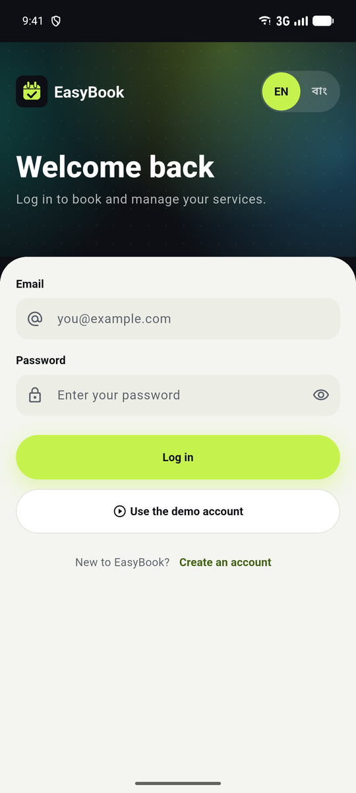 | 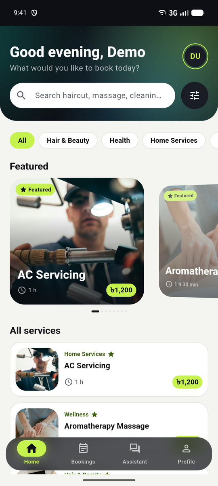 | 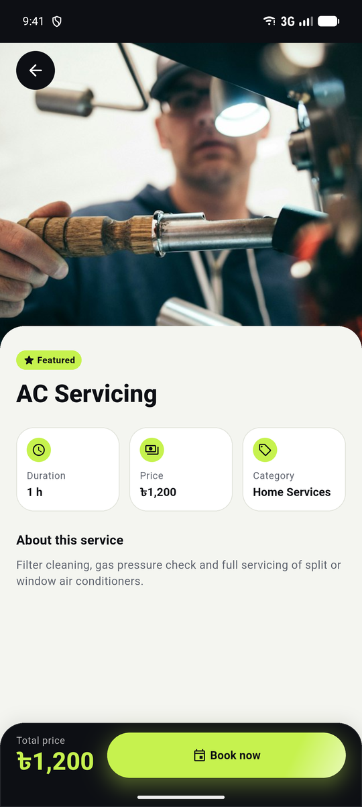 | 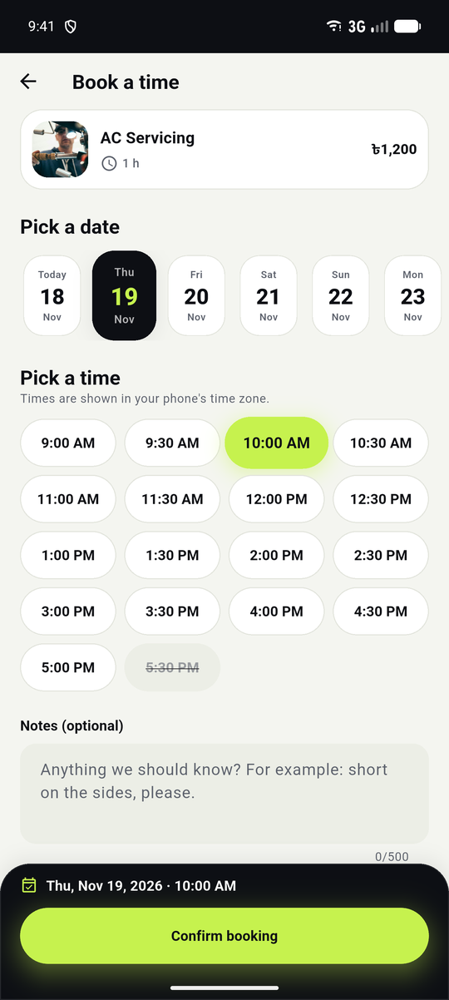 |

| My bookings | Booking detail | AI assistant | Assistant reply |
|---|---|---|---|
| 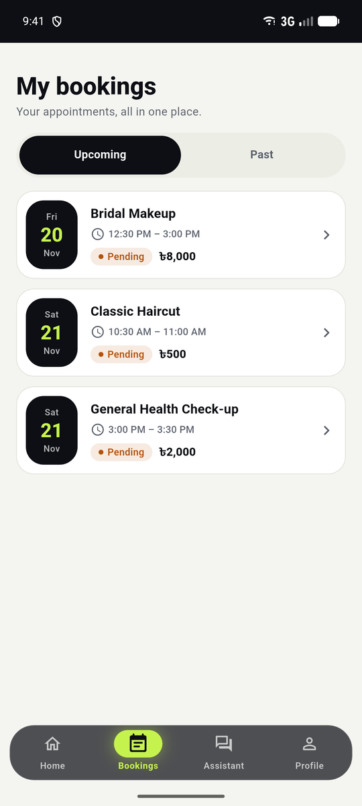 | 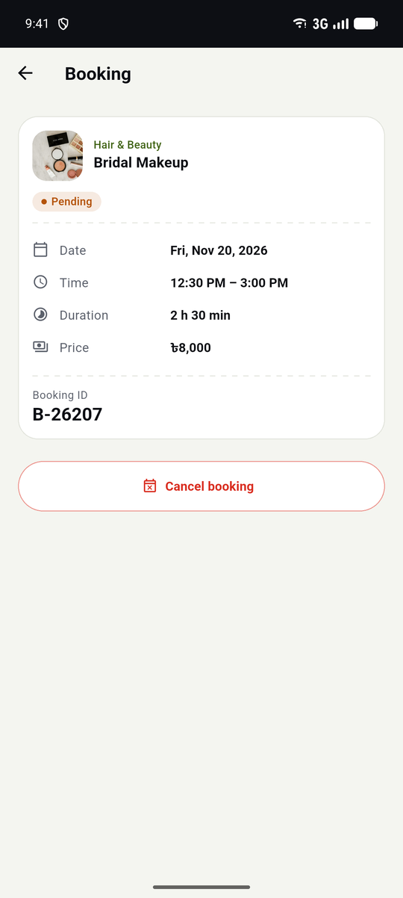 | 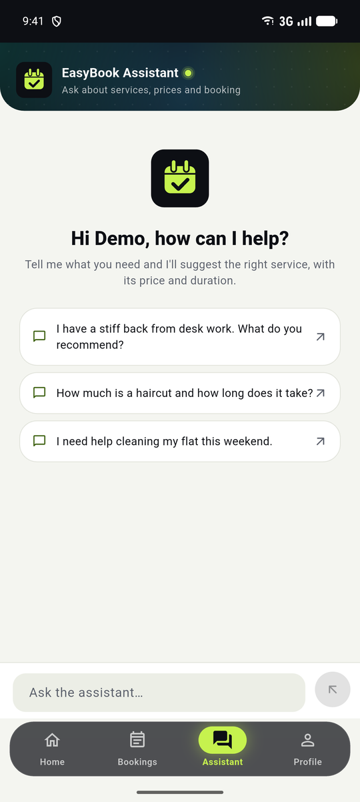 | 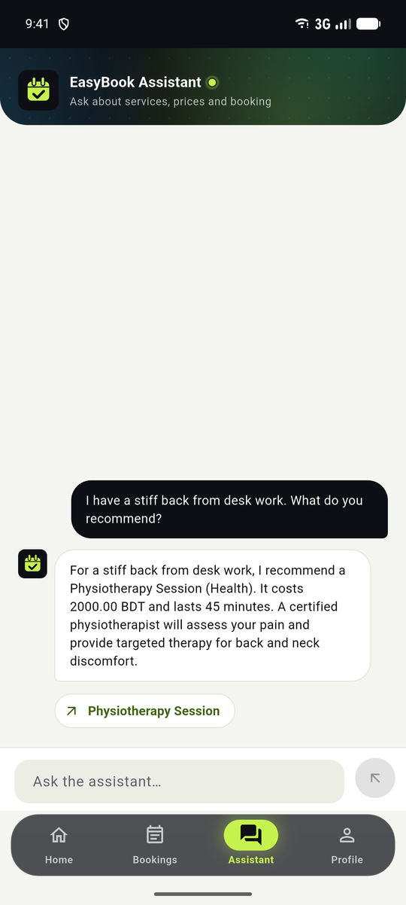 |

| Profile | বাংলা (Bengali) | Dark mode | Appearance |
|---|---|---|---|
| 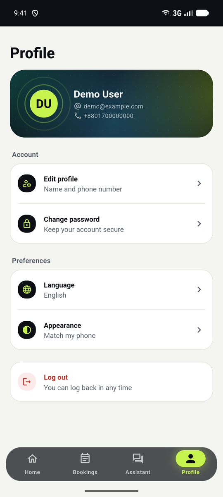 | 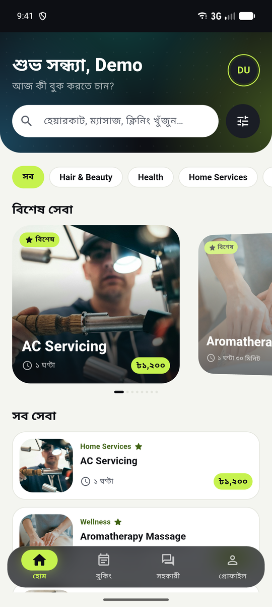 | 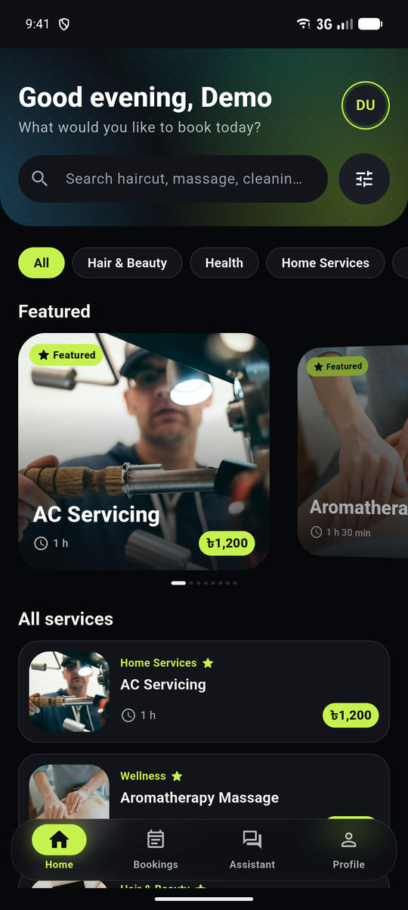 | 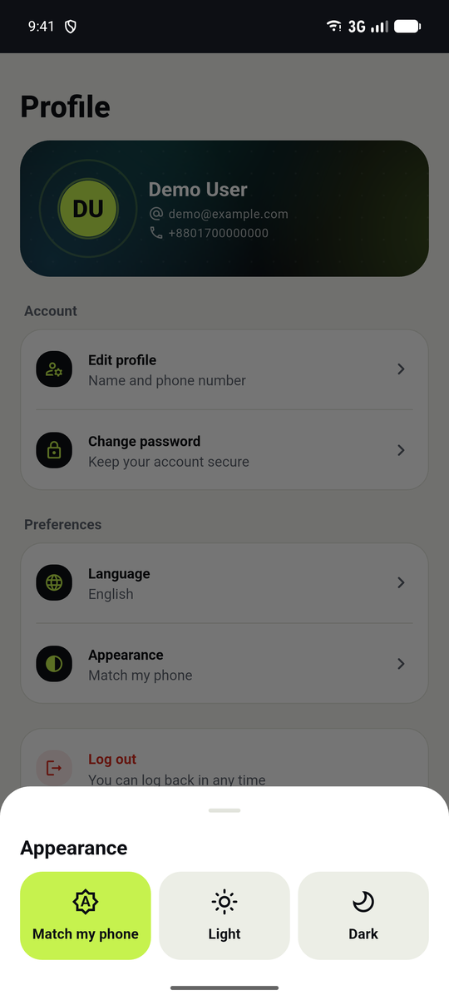 |

All screenshots were taken from a production release build on an Android emulator (Pixel, Android
17, gesture navigation), logged in with the demo account, against the live API. Service and category
names stay in English on the Bengali screen because the API sends them that way.

---

## Features

- **Account:** register, log in (with a one-tap demo login), stay logged in across restarts, log out.
  An expired session sends the user back to login with an explanation.
- **Services:** featured carousel (swipe with a 3D tilt and photo parallax), search as you type,
  category chips, price range filter, and endless scrolling with pagination. Changing a search or
  filter shows skeleton cards until the new results arrive.
- **Booking:** pick a day, see every time slot (booked or past ones are crossed out), add notes,
  confirm. If someone else takes the slot first, the app explains and reloads the free times.
- **My bookings:** Upcoming and Past tabs, booking details, and cancelling (pending bookings only,
  after a confirmation dialog). Each booking shows a short, easy-to-read number such as `B-26047`.
- **Profile:** edit name and phone (the email is locked), change password, switch language, and
  pick the appearance (match the phone, light or dark). Tapping the avatar on Home opens Profile.
- **AI assistant:** chat about services. Replies show tappable chips that open the suggested
  service. The conversation is kept while you use other tabs.
- **Navigation:** a floating, see-through bottom bar that slides away while you scroll down and comes
  back when you scroll up. Tapping the tab you are already on scrolls to the top and refreshes it
  (Home and My Bookings).
- **Fast browsing:** services, categories and service details are cached in memory for a few
  minutes, so going back and forth does not call the API every time. Pull to refresh always loads
  fresh data.
- **Every screen** handles loading (skeletons), empty, error (with retry) and success states.

---

## Architecture

Clean architecture, organised by feature. The dependency rule:

```
presentation  ──▶  domain  ◀──  data
 (widgets,         (entities,     (Dio data sources,
  blocs)            use cases,     JSON models,
                    repository     repository
                    contracts)     implementations)
```

- **Domain** is plain Dart: no Flutter, no Dio, no JSON. It defines entities, repository
  interfaces and one small use case per action.
- **Data** implements the repository interfaces. Data sources only call the API and throw;
  repositories turn every exception into a typed `Failure` and return `Either<Failure, T>`.
- **Presentation** blocs and cubits depend only on use cases, never on Dio or storage.

```
lib/
├── main_development.dart / main_staging.dart / main_production.dart
├── bootstrap.dart                 shared start-up for every flavor
├── app/                           MaterialApp.router, theme mode, status bar strip, bottom-nav shell
├── core/
│   ├── cache/                     small in-memory cache with a time limit (used by repositories)
│   ├── config/                    flavors, AppConfig, Env (the only place with the API URL)
│   ├── constants/                 API paths, limits and timeouts, storage keys
│   ├── di/                        get_it registrations, grouped by feature
│   ├── error/                     sealed Failure hierarchy, data-layer exceptions
│   ├── network/                   Dio client, auth interceptor, error mapping, response envelope
│   ├── router/                    go_router routes and the auth redirect
│   ├── storage/                   secure token storage
│   ├── theme/                     colors, text styles, spacing, icons, page transitions, themes
│   ├── localization/              generated translation keys
│   ├── utils/                     date, price, duration formatters, validators
│   └── widgets/                   shared widgets (button, text field, empty/error views, motion, …)
└── features/
    ├── auth/                      splash, login, register, session
    ├── services/                  home, search, filters, detail, availability
    ├── appointments/              booking, my bookings, detail, cancel
    ├── profile/                   profile, edit, change password, language
    └── ai_assistant/              chat
```

Each feature has the same inside: `data/` (datasources, models, repositories), `domain/`
(entities, repositories, usecases) and `presentation/` (bloc, pages, widgets). Tests mirror `lib/`.

### How a request flows

`Widget → Bloc/Cubit → UseCase → Repository (interface) → RepositoryImpl → RemoteDataSource → Dio`

The answer comes back as `Either<Failure, T>`. The bloc emits a state with the data or the failure.
The widget shows the API's own message, which is already user-friendly.

---

## Tech choices

| Need | Choice | Why |
|---|---|---|
| State | `flutter_bloc` | Predictable, easy to test with `bloc_test`. Cubits for simple screens, Blocs with events where events help (auth, search with debounce and paging). |
| Navigation | `go_router` | One redirect function decides splash / login / app from the auth state. A `StatefulShellRoute` keeps each tab's history. |
| Networking | `dio` | Interceptors for the token and for 401 handling in one place. Per-request timeouts (the AI call waits longer). |
| Errors | `fpdart` `Either` | Every repository call returns success or a typed failure, so no exception escapes to the UI. |
| DI | `get_it` | Simple service locator. Singletons for data and domain, factories for blocs. |
| JSON | `json_serializable` | Generated, type-safe parsing. Models convert to entities with `toEntity()`. |
| Token | `flutter_secure_storage` | Keychain / Keystore. Only the JWT is stored. |
| Language | `easy_localization` | JSON translations for `en` and `bn`, generated keys, the choice is saved. |
| Images | `cached_network_image` | Caches service photos; shows a shimmer while loading. |
| Lints | `very_good_analysis` + `bloc_lint` | Strict analysis, zero issues. |

No other packages were added. The search debounce, the skeleton shimmer, the logo, the cache and
every animation (aurora background, entrances, confetti, pulse rings, page transitions) are small
pieces of in-house code in `core/`.

---

## Design decisions worth knowing

- **One place for 401s.** `AuthInterceptor` adds the token. A 401 from a protected route clears
  the token and tells `AuthBloc` the session expired, and the router redirects to login. A 401 from
  `POST /auth/login` is just "wrong password" and never logs anyone out.
- **Times.** The API speaks UTC. The app converts to local time only for display. A booking sends
  back the slot's `startTime` exactly as the server sent it. The availability `date` is the picked
  calendar day (`yyyy-MM-dd`), never a UTC conversion.
- **Prices** arrive as strings (`"500.00"`), are parsed once in the model, and are shown as `৳500`
  (Bengali digits in Bengali).
- **No double submits.** Login, register, booking, cancel and profile forms ignore taps while a
  request is in flight, and the button shows a spinner.
- **No stale results.** Search waits 300 ms after typing. Each list or slot request is numbered,
  so a slow old answer can never replace a newer one.
- **Booking conflicts.** On a 409 (slot just taken) or 422 (slot no longer bookable) the app shows
  the server's reason, clears the choice and reloads the free slots. On a network error it keeps
  the choice so the user can retry.
- **Lists stay current.** Creating or cancelling a booking broadcasts a change, and My Bookings
  reloads both tabs.
- **Caching in the data layer only.** `ServicesRepositoryImpl` keeps categories for an hour and
  featured services, list pages (per search, filter and page) and service details for 5 minutes
  (`core/cache/memory_cache.dart`). Blocs only pass `forceRefresh: true` on pull to refresh.
  Failures are never cached. Availability, bookings and the profile are never cached, because they
  change all the time or are personal. The services catalog is the same for every user, so the cache
  does not need clearing on logout.
- **System bars.** Every screen starts below a solid status bar strip
  (`app/status_bar_strip.dart`, set once in `MaterialApp.builder`). The floating navigation bar sits
  above the Android keys or gesture handle, and on Android the area behind the system keys is
  filled, so scrolling content never shows through them.
- **Motion with care.** Every animation is skipped when the phone's "remove animations" setting is
  on. List cards animate once per set of results and never replay while scrolling.
- **Waking the server.** The splash screen calls `GET /health` right away and explains the wait if
  the free server is asleep. Network timeouts are 60 s for that reason.
- **Language switch without losing state.** `tr()` reads a global, so after a language change the
  app marks every widget for one rebuild instead of recreating the tree. Navigation, scroll
  position and the chat survive the switch.
- **Material library.** The Very Good CLI template imported the new `material_ui` package, but
  go_router, easy_localization and flutter_localizations still use the SDK's
  `package:flutter/material.dart`. Mixing two Material libraries gives two different `MaterialApp`
  and `Theme` types, so the app uses the SDK one everywhere.
- **Design system.** All colors, text styles, spacing, sizes, durations and icons live in
  `core/theme` (see the design section of [`docs/PLAN.md`](docs/PLAN.md)). Status colors are always
  paired with a text label.

---

## Flavors and environments

Three flavors from Very Good CLI, each with its own app name and icon color, so they can be
installed side by side:

| Flavor | App name | Android id | Icon | Entry point |
|---|---|---|---|---|
| production | EasyBook | `com.shaad.easybook` | ink + lime | `lib/main_production.dart` |
| staging | EasyBook Staging | `com.shaad.easybook.stg` | slate + white | `lib/main_staging.dart` |
| development | EasyBook Dev | `com.shaad.easybook.dev` | amber + white | `lib/main_development.dart` |

The API base URL is written in **one place**, [`lib/core/config/env.dart`](lib/core/config/env.dart).
All flavors currently use the production API. To use a local backend, change only
`developmentBaseUrl` there (Android emulator: `http://10.0.2.2:4000/api/v1`, iOS simulator:
`http://localhost:4000/api/v1`). Debug logging (method, URL, status; never tokens or bodies) is on
only in the development flavor.

---

## Getting started

Requirements: Flutter 3.47 (Dart 3.13), Xcode for iOS, Android SDK for Android.

```sh
flutter pub get
```

Run a flavor:

```sh
flutter run --flavor development --target lib/main_development.dart
flutter run --flavor production --target lib/main_production.dart
```

Code generation, only needed after changing models or translations (generated files are
committed):

```sh
dart run build_runner build --delete-conflicting-outputs
dart run easy_localization:generate -S assets/translations -O lib/core/localization -o locale_keys.g.dart -f keys
```

---

## Build the APK

```sh
flutter build apk --release --flavor production --target lib/main_production.dart
```

The APK is written to `build/app/outputs/flutter-apk/app-production-release.apk` (about 59 MB,
all CPU types in one file; add `--split-per-abi` for smaller per-device APKs).

**Signing:** when `android/key.properties` (or the `ANDROID_KEYSTORE_*` environment variables) is
present, the release build is signed with that key. Without it, the build falls back to the debug
key, so anyone can build an installable APK for testing. A Play Store upload needs the real key.

---

## Tests

```sh
very_good test --coverage --test-randomize-ordering-seed random
flutter analyze
dart run bloc_tools:bloc lint .
```

- **336 tests** in 51 files, **84% line coverage**, `flutter analyze` and `bloc lint` at zero
  issues.
- Every bloc and cubit (success, failure and key transitions such as debounce, paging, stale
  answers, 409 reload, retry), every repository (success and each failure mapping), the network
  layer (envelope parsing, error mapping, 401 handling), the cache (expiry, force refresh, failures
  not cached, availability never cached), formatters and validators.
- Widget tests for shared widgets and the main forms.
- [`test/app/layout_stress_test.dart`](test/app/layout_stress_test.dart) renders all 13 main
  screens on an iPhone SE-sized screen, in dark mode, at 200% text size, in English and in real
  Bengali text, and fails on any overflow. The same file checks 48 dp tap targets, labels on
  everything tappable, and dark-mode text contrast.

---

## App icon

[`tool/generate_icons.py`](tool/generate_icons.py) draws the logo (a lime calendar on ink, with the
check mark cut out) and writes every Android and iOS icon size, the Android adaptive icon (with a
themed monochrome version), and both launch screens. Each flavor gets its own colors. Re-run it
after changing the logo:

```sh
python3 tool/generate_icons.py   # needs Pillow
```

Inside the app the same logo is drawn in code (`core/widgets/app_logo.dart`), so it is sharp at
every size; on the splash screen it builds itself piece by piece.

---

## Project documents

- [`docs/API.md`](docs/API.md): the API contract this app is built against.
- [`docs/PLAN.md`](docs/PLAN.md): the build plan, step by step.

[license_badge]: https://img.shields.io/badge/license-MIT-blue.svg
[license_link]: https://opensource.org/licenses/MIT
[very_good_analysis_badge]: https://img.shields.io/badge/style-very_good_analysis-B22C89.svg
[very_good_analysis_link]: https://pub.dev/packages/very_good_analysis
